# Modelo entidade relacionamento do Muriaé Pronto

O modelo reúne 27 tabelas de domínio e seus relacionamentos. O atendimento é a entidade central dos registros de triagem, evolução, exames, prescrições e acompanhamento.

## Diagrama

```mermaid
erDiagram
    acompanhante {
        int id_acompanhante PK
        int id_atendimento FK
        int id_usuario FK
        varchar nome
        varchar parentesco
        varchar documento
        varchar telefone
        datetime data_hora_entrada
        datetime data_hora_saida
    }
    administracao {
        int id_administracao PK
        int id_item_prescricao FK
        datetime data_hora_prevista
        varchar situacao
        int id_usuario FK
        datetime data_hora
        varchar motivo
    }
    anexo {
        int id_anexo PK
        int id_atendimento FK
        int id_exame FK
        int id_usuario FK
        varchar nome_original
        varchar caminho_arquivo
        varchar tipo_arquivo
        bigint tamanho
        datetime data_hora
    }
    atendimento {
        int id_atendimento PK
        int id_paciente FK
        int id_usuario_admissao FK
        int id_medico FK
        varchar numero UK
        datetime data_hora_chegada
        datetime data_hora_inicio_atendimento
        int id_classificacao_inicio FK
        int minutos_espera
        varchar status
        text observacao_inicial
        datetime data_hora_inicio_observacao
        varchar leito_observacao
        varchar desfecho
        varchar cid_principal FK
        datetime data_hora_obito
        varchar declaracao_obito
        tinyint termo_alta_pedido
        text resumo_final
        text observacoes_finais
        datetime data_hora_encerramento
        int tempo_alvo_inicio
    }
    chamada {
        int id_chamada PK
        int id_atendimento FK
        int id_usuario FK
        varchar local
        datetime data_hora
    }
    cid10 {
        varchar codigo PK
        varchar descricao
    }
    classificacao_risco {
        int id_classificacao PK
        varchar nome UK
        varchar cor
        tinyint ordem_prioridade
        smallint tempo_alvo_minutos
        tinyint ativo
    }
    documento {
        int id_documento PK
        int id_atendimento FK
        int id_usuario FK
        varchar tipo
        text conteudo
        tinyint dias_afastamento
        varchar cid FK
        varchar destino
        datetime data_hora
    }
    evolucao_enfermagem {
        int id_evolucao_enfermagem PK
        int id_atendimento FK
        int id_usuario FK
        datetime data_hora
        text avaliacao
        text diagnostico
        text planejamento
        text implementacao
        text evolucao
    }
    evolucao_medica {
        int id_evolucao PK
        int id_atendimento FK
        int id_medico FK
        datetime data_hora
        text evolucao
        text observacoes
        text hipotese_diagnostica
        text conclusao_clinica
    }
    exame {
        int id_exame PK
        int id_atendimento FK
        int id_solicitante FK
        int id_usuario_resultado FK
        varchar descricao
        datetime data_hora_solicitacao
        varchar status
        text resultado
        datetime data_hora_resultado
    }
    log_auditoria {
        bigint id_log PK
        int id_usuario FK
        varchar acao
        varchar entidade
        bigint registro_id
        datetime data_hora
        text detalhes
    }
    medicamento {
        int id_medicamento PK
        varchar nome
        varchar apresentacao
        tinyint ativo
    }
    notificacao {
        int id_notificacao PK
        int id_atendimento FK
        int id_usuario FK
        varchar agravo
        varchar tipo
        datetime data_hora
        varchar situacao
        int id_usuario_notificacao FK
        datetime data_hora_notificacao
        varchar numero_sinan
    }
    paciente {
        int id_paciente PK
        varchar nome_completo
        varchar nome_social
        varchar cpf UK
        char cns UK
        date data_nascimento
        varchar nome_mae
        varchar sexo
        varchar telefone
        varchar endereco
        varchar numero
        varchar bairro
        varchar cidade
        char estado
        varchar nome_contato
        varchar telefone_contato
        varchar alergias
        tinyint nao_identificado
        varchar caracteristicas
    }
    passagem_plantao {
        int id_passagem PK
        int id_atendimento FK
        int id_usuario FK
        text situacao
        text historico
        text avaliacao
        text recomendacao
        datetime data_hora
        int id_usuario_recebimento FK
        datetime data_hora_recebimento
    }
    perfil {
        int id_perfil PK
        varchar nome UK
        varchar descricao
        tinyint ativo
    }
    prescricao {
        int id_prescricao PK
        int id_atendimento FK
        int id_medico FK
        datetime data_hora
        text observacoes
        varchar status
    }
    prescricao_medicamento {
        int id_item_prescricao PK
        int id_prescricao FK
        int id_medicamento FK
        varchar dose
        varchar via
        varchar frequencia
        tinyint intervalo_horas
        tinyint se_necessario
        datetime data_hora_inicio
        text observacoes
        varchar situacao
    }
    protocolo {
        int id_protocolo PK
        varchar nome UK
        varchar marco_inicial
        smallint janela_minutos
        varchar fonte
        tinyint ativo
    }
    protocolo_atendimento {
        int id_protocolo_atendimento PK
        int id_atendimento FK
        int id_protocolo FK
        int id_usuario FK
        datetime data_hora_abertura
        datetime inicio_sintomas
        varchar situacao
        datetime data_hora_encerramento
        varchar observacao
    }
    protocolo_etapa {
        int id_etapa PK
        int id_protocolo FK
        varchar descricao
        smallint meta_minutos
        tinyint ordem
    }
    protocolo_registro {
        int id_registro PK
        int id_protocolo_atendimento FK
        int id_etapa FK
        int id_usuario FK
        datetime data_hora
    }
    reclassificacao {
        int id_reclassificacao PK
        int id_atendimento FK
        int id_usuario FK
        int id_classificacao_anterior FK
        int id_classificacao_nova FK
        text motivo
        datetime data_hora
    }
    sinal_vital {
        int id_sinal_vital PK
        int id_atendimento FK
        int id_usuario FK
        datetime data_hora
        varchar pressao_arterial
        decimal temperatura
        smallint frequencia_cardiaca
        smallint frequencia_respiratoria
        tinyint saturacao
        tinyint oxigenio_suplementar
        char nivel_consciencia
        tinyint dor
        smallint glicemia
        varchar observacoes
    }
    triagem {
        int id_triagem PK
        int id_atendimento FK,UK
        int id_enfermeiro FK
        int id_classificacao FK
        text queixa_principal
        text observacoes_iniciais
        varchar pressao_arterial
        decimal temperatura
        smallint frequencia_cardiaca
        smallint frequencia_respiratoria
        tinyint saturacao
        tinyint oxigenio_suplementar
        char nivel_consciencia
        tinyint gestante
        tinyint dor
        smallint glicemia
        decimal peso
        datetime data_hora
        datetime data_hora_reclassificacao
    }
    usuario {
        int id_usuario PK
        int id_perfil FK
        varchar nome
        varchar login UK
        varchar email UK
        varchar registro_profissional
        varchar senha_hash
        tinyint ativo
        datetime data_cadastro
    }
    atendimento ||--o{ acompanhante : "id_atendimento"
    usuario ||--o{ acompanhante : "id_usuario"
    prescricao_medicamento ||--o{ administracao : "id_item_prescricao"
    usuario |o--o{ administracao : "id_usuario"
    atendimento ||--o{ anexo : "id_atendimento"
    exame |o--o{ anexo : "id_exame"
    usuario ||--o{ anexo : "id_usuario"
    cid10 |o--o{ atendimento : "cid_principal"
    classificacao_risco |o--o{ atendimento : "id_classificacao_inicio"
    usuario |o--o{ atendimento : "id_medico"
    paciente ||--o{ atendimento : "id_paciente"
    usuario ||--o{ atendimento : "id_usuario_admissao"
    atendimento ||--o{ chamada : "id_atendimento"
    usuario ||--o{ chamada : "id_usuario"
    atendimento ||--o{ documento : "id_atendimento"
    cid10 |o--o{ documento : "cid"
    usuario ||--o{ documento : "id_usuario"
    atendimento ||--o{ evolucao_enfermagem : "id_atendimento"
    usuario ||--o{ evolucao_enfermagem : "id_usuario"
    atendimento ||--o{ evolucao_medica : "id_atendimento"
    usuario ||--o{ evolucao_medica : "id_medico"
    atendimento ||--o{ exame : "id_atendimento"
    usuario ||--o{ exame : "id_solicitante"
    usuario |o--o{ exame : "id_usuario_resultado"
    usuario ||--o{ log_auditoria : "id_usuario"
    atendimento ||--o{ notificacao : "id_atendimento"
    usuario ||--o{ notificacao : "id_usuario"
    usuario |o--o{ notificacao : "id_usuario_notificacao"
    atendimento ||--o{ passagem_plantao : "id_atendimento"
    usuario |o--o{ passagem_plantao : "id_usuario_recebimento"
    usuario ||--o{ passagem_plantao : "id_usuario"
    atendimento ||--o{ prescricao : "id_atendimento"
    usuario ||--o{ prescricao : "id_medico"
    medicamento ||--o{ prescricao_medicamento : "id_medicamento"
    prescricao ||--o{ prescricao_medicamento : "id_prescricao"
    atendimento ||--o{ protocolo_atendimento : "id_atendimento"
    protocolo ||--o{ protocolo_atendimento : "id_protocolo"
    usuario ||--o{ protocolo_atendimento : "id_usuario"
    protocolo ||--o{ protocolo_etapa : "id_protocolo"
    protocolo_etapa ||--o{ protocolo_registro : "id_etapa"
    protocolo_atendimento ||--o{ protocolo_registro : "id_protocolo_atendimento"
    usuario ||--o{ protocolo_registro : "id_usuario"
    classificacao_risco ||--o{ reclassificacao : "id_classificacao_anterior"
    atendimento ||--o{ reclassificacao : "id_atendimento"
    classificacao_risco ||--o{ reclassificacao : "id_classificacao_nova"
    usuario ||--o{ reclassificacao : "id_usuario"
    atendimento ||--o{ sinal_vital : "id_atendimento"
    usuario ||--o{ sinal_vital : "id_usuario"
    atendimento ||--o| triagem : "id_atendimento"
    classificacao_risco ||--o{ triagem : "id_classificacao"
    usuario ||--o{ triagem : "id_enfermeiro"
    perfil ||--o{ usuario : "id_perfil"
```

## Dicionário de dados

| Tabela | Coluna | Tipo | Nulo | Default | Chave |
| --- | --- | --- | --- | --- | --- |
| acompanhante | id_acompanhante | int | NO | None | PRI |
| acompanhante | id_atendimento | int | NO | None | MUL |
| acompanhante | id_usuario | int | NO | None | MUL |
| acompanhante | nome | varchar(150) | NO | None |  |
| acompanhante | parentesco | varchar(50) | YES | None |  |
| acompanhante | documento | varchar(30) | YES | None |  |
| acompanhante | telefone | varchar(20) | YES | None |  |
| acompanhante | data_hora_entrada | datetime | NO | None |  |
| acompanhante | data_hora_saida | datetime | YES | None |  |
| administracao | id_administracao | int | NO | None | PRI |
| administracao | id_item_prescricao | int | NO | None | MUL |
| administracao | data_hora_prevista | datetime | YES | None | MUL |
| administracao | situacao | varchar(20) | NO | None |  |
| administracao | id_usuario | int | YES | None | MUL |
| administracao | data_hora | datetime | YES | None |  |
| administracao | motivo | varchar(255) | YES | None |  |
| anexo | id_anexo | int | NO | None | PRI |
| anexo | id_atendimento | int | NO | None | MUL |
| anexo | id_exame | int | YES | None | MUL |
| anexo | id_usuario | int | NO | None | MUL |
| anexo | nome_original | varchar(255) | NO | None |  |
| anexo | caminho_arquivo | varchar(500) | NO | None |  |
| anexo | tipo_arquivo | varchar(120) | YES | None |  |
| anexo | tamanho | bigint | YES | None |  |
| anexo | data_hora | datetime | NO | CURRENT_TIMESTAMP |  |
| atendimento | id_atendimento | int | NO | None | PRI |
| atendimento | id_paciente | int | NO | None | MUL |
| atendimento | id_usuario_admissao | int | NO | None | MUL |
| atendimento | id_medico | int | YES | None | MUL |
| atendimento | numero | varchar(30) | NO | None | UNI |
| atendimento | data_hora_chegada | datetime | NO | None | MUL |
| atendimento | data_hora_inicio_atendimento | datetime | YES | None |  |
| atendimento | id_classificacao_inicio | int | YES | None | MUL |
| atendimento | minutos_espera | int | YES | None |  |
| atendimento | status | varchar(40) | NO | None | MUL |
| atendimento | observacao_inicial | text | YES | None |  |
| atendimento | data_hora_inicio_observacao | datetime | YES | None |  |
| atendimento | leito_observacao | varchar(40) | YES | None |  |
| atendimento | desfecho | varchar(30) | YES | None |  |
| atendimento | cid_principal | varchar(4) | YES | None | MUL |
| atendimento | data_hora_obito | datetime | YES | None |  |
| atendimento | declaracao_obito | varchar(20) | YES | None |  |
| atendimento | termo_alta_pedido | tinyint | YES | None |  |
| atendimento | resumo_final | text | YES | None |  |
| atendimento | observacoes_finais | text | YES | None |  |
| atendimento | data_hora_encerramento | datetime | YES | None |  |
| atendimento | tempo_alvo_inicio | int | YES | None |  |
| chamada | id_chamada | int | NO | None | PRI |
| chamada | id_atendimento | int | NO | None | MUL |
| chamada | id_usuario | int | NO | None | MUL |
| chamada | local | varchar(60) | NO | None |  |
| chamada | data_hora | datetime | NO | None | MUL |
| cid10 | codigo | varchar(4) | NO | None | PRI |
| cid10 | descricao | varchar(300) | NO | None |  |
| classificacao_risco | id_classificacao | int | NO | None | PRI |
| classificacao_risco | nome | varchar(50) | NO | None | UNI |
| classificacao_risco | cor | varchar(20) | NO | None |  |
| classificacao_risco | ordem_prioridade | tinyint | NO | None | MUL |
| classificacao_risco | tempo_alvo_minutos | smallint | NO | 0 |  |
| classificacao_risco | ativo | tinyint | NO | 1 |  |
| documento | id_documento | int | NO | None | PRI |
| documento | id_atendimento | int | NO | None | MUL |
| documento | id_usuario | int | NO | None | MUL |
| documento | tipo | varchar(30) | NO | None |  |
| documento | conteudo | text | YES | None |  |
| documento | dias_afastamento | tinyint | YES | None |  |
| documento | cid | varchar(4) | YES | None | MUL |
| documento | destino | varchar(150) | YES | None |  |
| documento | data_hora | datetime | NO | None |  |
| evolucao_enfermagem | id_evolucao_enfermagem | int | NO | None | PRI |
| evolucao_enfermagem | id_atendimento | int | NO | None | MUL |
| evolucao_enfermagem | id_usuario | int | NO | None | MUL |
| evolucao_enfermagem | data_hora | datetime | NO | None |  |
| evolucao_enfermagem | avaliacao | text | YES | None |  |
| evolucao_enfermagem | diagnostico | text | YES | None |  |
| evolucao_enfermagem | planejamento | text | YES | None |  |
| evolucao_enfermagem | implementacao | text | YES | None |  |
| evolucao_enfermagem | evolucao | text | YES | None |  |
| evolucao_medica | id_evolucao | int | NO | None | PRI |
| evolucao_medica | id_atendimento | int | NO | None | MUL |
| evolucao_medica | id_medico | int | NO | None | MUL |
| evolucao_medica | data_hora | datetime | NO | None | MUL |
| evolucao_medica | evolucao | text | NO | None |  |
| evolucao_medica | observacoes | text | YES | None |  |
| evolucao_medica | hipotese_diagnostica | text | YES | None |  |
| evolucao_medica | conclusao_clinica | text | YES | None |  |
| exame | id_exame | int | NO | None | PRI |
| exame | id_atendimento | int | NO | None | MUL |
| exame | id_solicitante | int | NO | None | MUL |
| exame | id_usuario_resultado | int | YES | None | MUL |
| exame | descricao | varchar(180) | NO | None |  |
| exame | data_hora_solicitacao | datetime | NO | None |  |
| exame | status | varchar(30) | NO | None | MUL |
| exame | resultado | text | YES | None |  |
| exame | data_hora_resultado | datetime | YES | None |  |
| log_auditoria | id_log | bigint | NO | None | PRI |
| log_auditoria | id_usuario | int | NO | None | MUL |
| log_auditoria | acao | varchar(180) | NO | None |  |
| log_auditoria | entidade | varchar(100) | YES | None | MUL |
| log_auditoria | registro_id | bigint | YES | None |  |
| log_auditoria | data_hora | datetime | NO | CURRENT_TIMESTAMP | MUL |
| log_auditoria | detalhes | text | YES | None |  |
| medicamento | id_medicamento | int | NO | None | PRI |
| medicamento | nome | varchar(180) | NO | None | MUL |
| medicamento | apresentacao | varchar(150) | YES | None |  |
| medicamento | ativo | tinyint | NO | 1 |  |
| migrations | id | bigint unsigned | NO | None | PRI |
| migrations | version | varchar(255) | NO | None |  |
| migrations | class | varchar(255) | NO | None |  |
| migrations | group | varchar(255) | NO | None |  |
| migrations | namespace | varchar(255) | NO | None |  |
| migrations | time | int | NO | None |  |
| migrations | batch | int unsigned | NO | None |  |
| notificacao | id_notificacao | int | NO | None | PRI |
| notificacao | id_atendimento | int | NO | None | MUL |
| notificacao | id_usuario | int | NO | None | MUL |
| notificacao | agravo | varchar(150) | NO | None |  |
| notificacao | tipo | varchar(20) | NO | None |  |
| notificacao | data_hora | datetime | NO | None |  |
| notificacao | situacao | varchar(20) | NO | None | MUL |
| notificacao | id_usuario_notificacao | int | YES | None | MUL |
| notificacao | data_hora_notificacao | datetime | YES | None |  |
| notificacao | numero_sinan | varchar(30) | YES | None |  |
| paciente | id_paciente | int | NO | None | PRI |
| paciente | nome_completo | varchar(150) | NO | None | MUL |
| paciente | nome_social | varchar(150) | YES | None |  |
| paciente | cpf | varchar(14) | YES | None | UNI |
| paciente | cns | char(15) | YES | None | UNI |
| paciente | data_nascimento | date | YES | None |  |
| paciente | nome_mae | varchar(150) | YES | None |  |
| paciente | sexo | varchar(30) | YES | None |  |
| paciente | telefone | varchar(20) | YES | None |  |
| paciente | endereco | varchar(180) | YES | None |  |
| paciente | numero | varchar(20) | YES | None |  |
| paciente | bairro | varchar(100) | YES | None |  |
| paciente | cidade | varchar(100) | YES | None |  |
| paciente | estado | char(2) | YES | None |  |
| paciente | nome_contato | varchar(150) | YES | None |  |
| paciente | telefone_contato | varchar(20) | YES | None |  |
| paciente | alergias | varchar(500) | YES | None |  |
| paciente | nao_identificado | tinyint | NO | 0 |  |
| paciente | caracteristicas | varchar(255) | YES | None |  |
| passagem_plantao | id_passagem | int | NO | None | PRI |
| passagem_plantao | id_atendimento | int | NO | None | MUL |
| passagem_plantao | id_usuario | int | NO | None | MUL |
| passagem_plantao | situacao | text | NO | None |  |
| passagem_plantao | historico | text | YES | None |  |
| passagem_plantao | avaliacao | text | NO | None |  |
| passagem_plantao | recomendacao | text | NO | None |  |
| passagem_plantao | data_hora | datetime | NO | None |  |
| passagem_plantao | id_usuario_recebimento | int | YES | None | MUL |
| passagem_plantao | data_hora_recebimento | datetime | YES | None |  |
| perfil | id_perfil | int | NO | None | PRI |
| perfil | nome | varchar(50) | NO | None | UNI |
| perfil | descricao | varchar(255) | YES | None |  |
| perfil | ativo | tinyint | NO | 1 |  |
| prescricao | id_prescricao | int | NO | None | PRI |
| prescricao | id_atendimento | int | NO | None | MUL |
| prescricao | id_medico | int | NO | None | MUL |
| prescricao | data_hora | datetime | NO | None | MUL |
| prescricao | observacoes | text | YES | None |  |
| prescricao | status | varchar(30) | NO | None |  |
| prescricao_medicamento | id_item_prescricao | int | NO | None | PRI |
| prescricao_medicamento | id_prescricao | int | NO | None | MUL |
| prescricao_medicamento | id_medicamento | int | NO | None | MUL |
| prescricao_medicamento | dose | varchar(80) | NO | None |  |
| prescricao_medicamento | via | varchar(60) | NO | None |  |
| prescricao_medicamento | frequencia | varchar(100) | NO | None |  |
| prescricao_medicamento | intervalo_horas | tinyint | YES | None |  |
| prescricao_medicamento | se_necessario | tinyint | NO | 0 |  |
| prescricao_medicamento | data_hora_inicio | datetime | YES | None |  |
| prescricao_medicamento | observacoes | text | YES | None |  |
| prescricao_medicamento | situacao | varchar(30) | NO | None | MUL |
| protocolo | id_protocolo | int | NO | None | PRI |
| protocolo | nome | varchar(80) | NO | None | UNI |
| protocolo | marco_inicial | varchar(20) | NO | None |  |
| protocolo | janela_minutos | smallint | YES | None |  |
| protocolo | fonte | varchar(255) | NO | None |  |
| protocolo | ativo | tinyint | NO | 1 |  |
| protocolo_atendimento | id_protocolo_atendimento | int | NO | None | PRI |
| protocolo_atendimento | id_atendimento | int | NO | None | MUL |
| protocolo_atendimento | id_protocolo | int | NO | None | MUL |
| protocolo_atendimento | id_usuario | int | NO | None | MUL |
| protocolo_atendimento | data_hora_abertura | datetime | NO | None |  |
| protocolo_atendimento | inicio_sintomas | datetime | YES | None |  |
| protocolo_atendimento | situacao | varchar(20) | NO | None |  |
| protocolo_atendimento | data_hora_encerramento | datetime | YES | None |  |
| protocolo_atendimento | observacao | varchar(255) | YES | None |  |
| protocolo_etapa | id_etapa | int | NO | None | PRI |
| protocolo_etapa | id_protocolo | int | NO | None | MUL |
| protocolo_etapa | descricao | varchar(120) | NO | None |  |
| protocolo_etapa | meta_minutos | smallint | NO | None |  |
| protocolo_etapa | ordem | tinyint | NO | None |  |
| protocolo_registro | id_registro | int | NO | None | PRI |
| protocolo_registro | id_protocolo_atendimento | int | NO | None | MUL |
| protocolo_registro | id_etapa | int | NO | None | MUL |
| protocolo_registro | id_usuario | int | NO | None | MUL |
| protocolo_registro | data_hora | datetime | NO | None |  |
| reclassificacao | id_reclassificacao | int | NO | None | PRI |
| reclassificacao | id_atendimento | int | NO | None | MUL |
| reclassificacao | id_usuario | int | NO | None | MUL |
| reclassificacao | id_classificacao_anterior | int | NO | None | MUL |
| reclassificacao | id_classificacao_nova | int | NO | None | MUL |
| reclassificacao | motivo | text | NO | None |  |
| reclassificacao | data_hora | datetime | NO | None |  |
| sinal_vital | id_sinal_vital | int | NO | None | PRI |
| sinal_vital | id_atendimento | int | NO | None | MUL |
| sinal_vital | id_usuario | int | NO | None | MUL |
| sinal_vital | data_hora | datetime | NO | None |  |
| sinal_vital | pressao_arterial | varchar(20) | NO | None |  |
| sinal_vital | temperatura | decimal(4,1) | NO | None |  |
| sinal_vital | frequencia_cardiaca | smallint | NO | None |  |
| sinal_vital | frequencia_respiratoria | smallint | NO | None |  |
| sinal_vital | saturacao | tinyint | NO | None |  |
| sinal_vital | oxigenio_suplementar | tinyint | NO | None |  |
| sinal_vital | nivel_consciencia | char(1) | NO | None |  |
| sinal_vital | dor | tinyint | YES | None |  |
| sinal_vital | glicemia | smallint | YES | None |  |
| sinal_vital | observacoes | varchar(255) | YES | None |  |
| triagem | id_triagem | int | NO | None | PRI |
| triagem | id_atendimento | int | NO | None | UNI |
| triagem | id_enfermeiro | int | NO | None | MUL |
| triagem | id_classificacao | int | NO | None | MUL |
| triagem | queixa_principal | text | NO | None |  |
| triagem | observacoes_iniciais | text | YES | None |  |
| triagem | pressao_arterial | varchar(20) | NO | None |  |
| triagem | temperatura | decimal(4,1) | NO | None |  |
| triagem | frequencia_cardiaca | smallint | NO | None |  |
| triagem | frequencia_respiratoria | smallint | NO | None |  |
| triagem | saturacao | tinyint | NO | None |  |
| triagem | oxigenio_suplementar | tinyint | YES | None |  |
| triagem | nivel_consciencia | char(1) | YES | None |  |
| triagem | gestante | tinyint | YES | None |  |
| triagem | dor | tinyint | YES | None |  |
| triagem | glicemia | smallint | YES | None |  |
| triagem | peso | decimal(5,2) | YES | None |  |
| triagem | data_hora | datetime | NO | None | MUL |
| triagem | data_hora_reclassificacao | datetime | YES | None |  |
| usuario | id_usuario | int | NO | None | PRI |
| usuario | id_perfil | int | NO | None | MUL |
| usuario | nome | varchar(150) | NO | None |  |
| usuario | login | varchar(80) | NO | None | UNI |
| usuario | email | varchar(150) | NO | None | UNI |
| usuario | registro_profissional | varchar(30) | YES | None |  |
| usuario | senha_hash | varchar(255) | NO | None |  |
| usuario | ativo | tinyint | NO | 1 |  |
| usuario | data_cadastro | datetime | NO | CURRENT_TIMESTAMP |  |

## Decisões do modelo

Atendimento é a entidade central: paciente, triagem, evoluções, exames, prescrições/itens/doses, protocolos/etapas/registros, documentos, acompanhantes, notificações e SBAR são associados por chaves estrangeiras. Triagem possui uma linha por atendimento; evolução e sinais vitais preservam múltiplos registros. Classificação é manual; NEWS2 é calculado na leitura e usa somente a escala 1 de saturação.

`atendimento.tempo_alvo_inicio` guarda a meta vigente quando o médico inicia o atendimento. Essa meta é usada no percentual histórico; atendimentos antigos sem snapshot ficam fora desse denominador. A meta atual da classificação permanece visível como referência.

CPF é opcional, mas, quando informado, precisa de formato, dígitos verificadores e unicidade válidos. CNS é opcional, com formato de 15 dígitos e unicidade; não há validação externa de cadastro. Dados de identificação e anexos exigem políticas institucionais antes de uso real.

As escritas autenticadas passam pelo filtro FluxoEscritaFilter, que serializa alterações ligadas ao mesmo banco MySQL entre workers. A restrição é da aplicação; acesso SQL direto não passa pelo filtro. As constraints de unicidade permanecem no banco. O mecanismo pressupõe um único servidor MySQL.

O log registra ações de aplicação e tem fallback para falhas; ele não é uma trilha imutável nem atomicamente obrigatória para todas as operações. Notificação de envio ao SINAN é um estado informado pelo usuário, sem transmissão externa.
